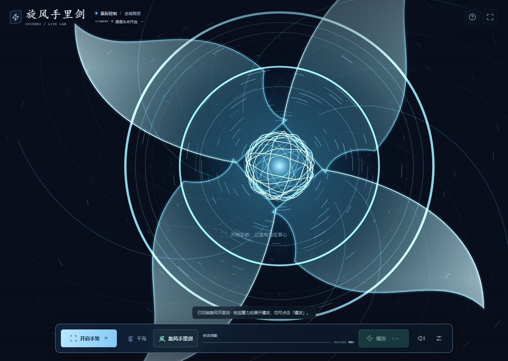
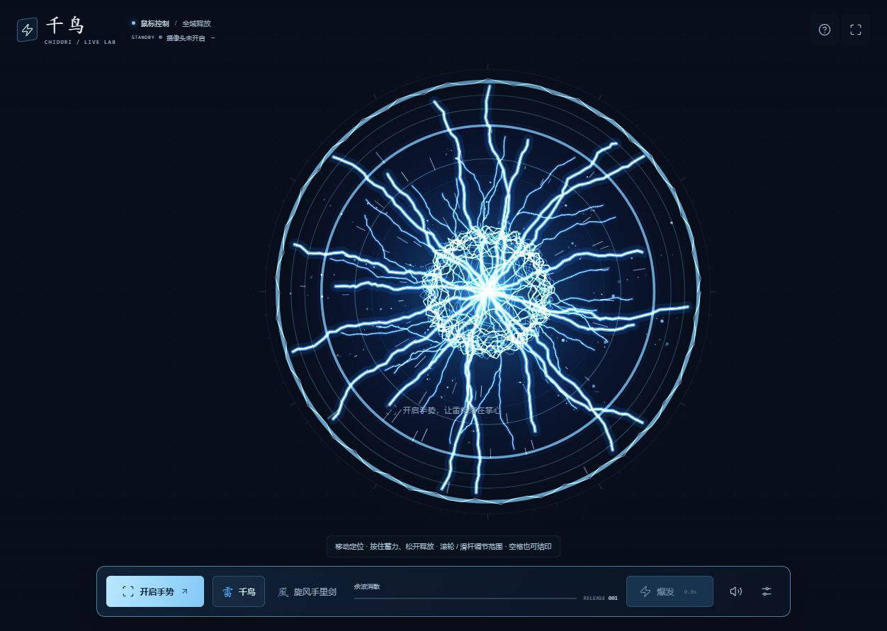

# 千鸟 CHIDORI · 手势特效实验室

把千鸟雷电和旋风手里剑放进摄像头画面：握拳聚能、张手爆发、双手拉开扩张到全屏。纯前端、浏览器本地识别，含原创程序合成音乐和音效。

A camera-first gesture playground with Chidori lightning, wind shuriken, and synthesized audio. Built with TypeScript, Canvas 2D, MediaPipe and Web Audio.

[在线体验](https://chidori.fhysy.cc.cd/) · [备用地址](https://chidori-gesture-lab.pages.dev/) · [报告问题](https://github.com/fanhuayishiy/chidori-gesture-lab/issues) · [MIT License](LICENSE)



## 功能

- **双模式**：千鸟蓝白电弧 / 四刃旋风手里剑，一键切换。
- **手势控制**：单手掌心跟随、握拳收缩、五指张开扩张，双手拉开覆盖屏幕。
- **3 秒爆发**：快速起势，强效果保持约 1 秒，随后渐散；冷却 1 秒，再次触发替换旧余波。
- **摄像头背景**：全屏镜像画面叠加透明特效，底部小菜单，设置可折叠。
- **免摄像头体验**：鼠标、触屏、键盘空格蓄力与释放。
- **原创音频**：合成氛围音乐、电爆 / 风切音效，独立音量和静音。
- **柔和模式**：减少粒子与动态变化，默认遵循系统“减少动态效果”设置。

## 快速开始

需要 Node.js **22.12+** 和 npm。推荐新版 Chrome / Edge。

```sh
git clone https://github.com/fanhuayishiy/chidori-gesture-lab.git
cd chidori-gesture-lab
npm ci
npm run setup:models
npm run dev
```

打开 [http://127.0.0.1:5173/](http://127.0.0.1:5173/)。

模型和 WASM 不提交到 Git：首次运行 `setup:models` 从 Google 官方下载固定版本手部模型，并从已锁定的 MediaPipe 包复制运行时。模型经过 SHA-256 校验；准备完毕后推理不再依赖外站请求。首次安装依赖和模型需要网络。资源丢失时重新运行该命令即可。

`.npmrc` 的 `legacy-peer-deps=true` 用于兼容 npm 的 Vitest 可选 peer 解析；依赖版本保存在锁文件中。`package.json` 的 `private: true` 仅防止误发布到 npm，不影响本项目开源。

## 怎么玩

1. 点击「开启手势」并允许摄像头，保持手掌完整、光照充足。
2. 握拳或双手靠拢约 0.3 秒，再稳定展开触发爆发；蓄力越久，强度越高。
3. 在底栏切换千鸟 / 旋风手里剑，也可直接点击「爆发」。
4. 没有摄像头时，在「设置」选择「鼠标体验」：移动定位、按住蓄力、松开释放；滚轮 / 范围滑杆调整大小。键盘焦点位于特效区时可按住空格蓄力。
5. 声音需点击体验或声音按钮后启动。右上角可全屏，设置内可调音量、柔和模式和手部骨架。

摄像头可能因画面铺满而裁切边缘；画面外的手掌不会驱动特效。持续张手不连发，范围滑杆不触发爆发。切换模式、失焦或跟踪丢失会取消未完成的蓄力。



## 隐私与兼容性

视频帧仅在当前浏览器内存中推理，不上传、不录制、不保存；项目没有服务端视频接口。停止手势或离开页面会释放摄像头。网页通过 HTTPS 或 localhost 使用摄像头，不要直接双击 HTML 或通过普通远程 HTTP 打开。

手势推理使用 CPU；弱设备自动降低渲染分辨率。光照、遮挡、姿态和设备性能会影响识别精度。柔和模式仍有亮度变化，对闪光敏感请谨慎体验。

## 构建和测试

先完成快速开始中的依赖安装与模型准备：

```sh
npm test
npm run build
npm run test:e2e
npm run preview
```

- 单元测试覆盖手势、状态机、几何、音频生命周期、摄像头投影和资源校验。
- 浏览器测试覆盖真实本地模型、公开图片合成摄像头、实际 Web Audio、鼠标 / 键盘 / 触屏和响应式布局。不会申请使用测试者的物理摄像头。
- 浏览器测试默认使用本机安装的 Microsoft Edge。其他环境可将 `playwright.config.ts` 的 `channel: 'msedge'` 移除，并执行 `npx playwright install chromium`。
- GitHub Actions 自动运行单元测试与生产构建；浏览器完整测试目前在本地执行。

合成摄像头验证不等同于所有真实摄像头、光照或手部姿态的现场验收。测试照片来源及许可见 [PROVENANCE](tests/fixtures/PROVENANCE.md)。

## 公网部署

构建产物位于 `dist/`，包含页面、模型、WASM 和第三方许可证。可部署到任何支持 HTTPS 的静态托管平台；详细步骤见 [部署指南](docs/DEPLOY.md)。

本仓库的 CI 不自动更新演示站，也不需要配置 Cloudflare Token。

## 项目结构

| 路径 | 用途 |
| --- | --- |
| `src/gesture.ts` / `src/hand-tracker.ts` | 手势计算和本地识别 |
| `src/camera-projection.ts` | 镜像、铺满裁切与可见掌心投影 |
| `src/energy.ts` / `src/effects.ts` | 连续能量、蓄力、爆发和冷却 |
| `src/lightning.ts` / `src/shuriken.ts` | 双模式 Canvas 渲染 |
| `src/effect-visuals.ts` | 爆发包络、几何与粒子预算 |
| `src/audio.ts` | 原创合成音乐与音效 |
| `src/main.ts` / `src/style.css` | 交互和界面 |
| `scripts/` | 模型安装及完整性校验 |
| `tests/` | Playwright 测试及公开测试照片 |
| `public/licenses/` | 随构建发布的第三方许可证 |

## 贡献与许可

欢迎提交 Issue 或 Pull Request。修改前请运行测试；涉及视觉、手势或音频的改动，请说明测试环境和验证方式。请勿提交真实摄像头照片 / 视频、Token、`.env`、`.wrangler` 或自动生成的模型和构建产物。

原创代码采用 [MIT](LICENSE)。MediaPipe、Lucide、测试照片及下载的模型保留各自上游许可，详见 [第三方声明](public/THIRD_PARTY_NOTICES.md)。音乐为原创程序合成，不含动漫原声。本项目为非官方技术实验，与相关动漫权利方无隶属或背书关系。
